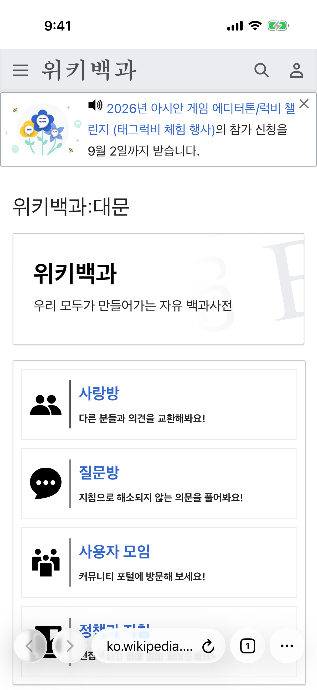
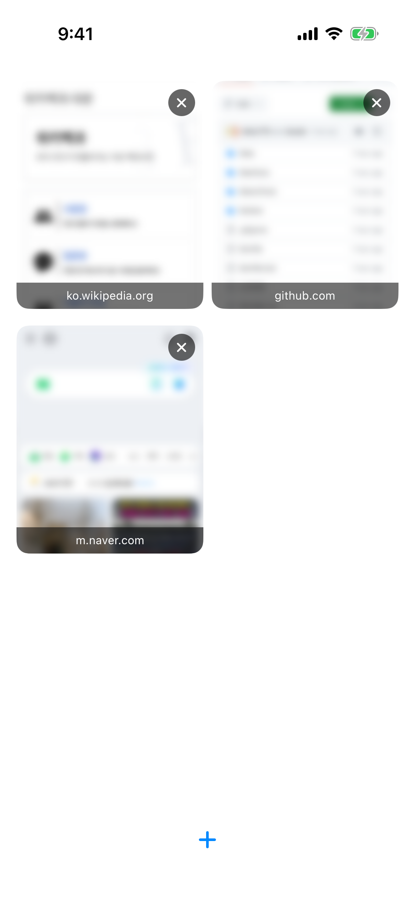
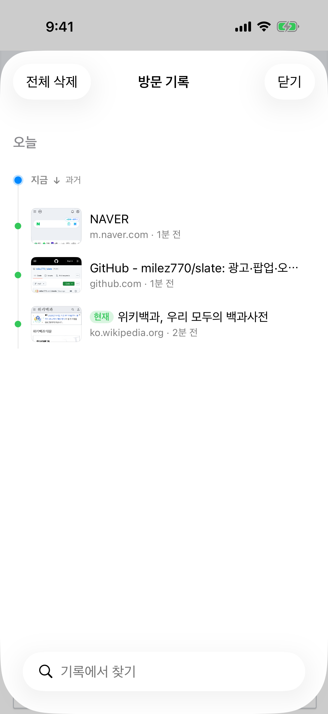
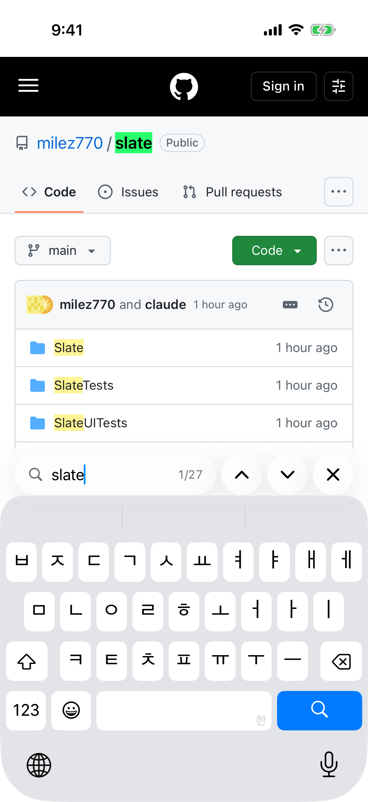
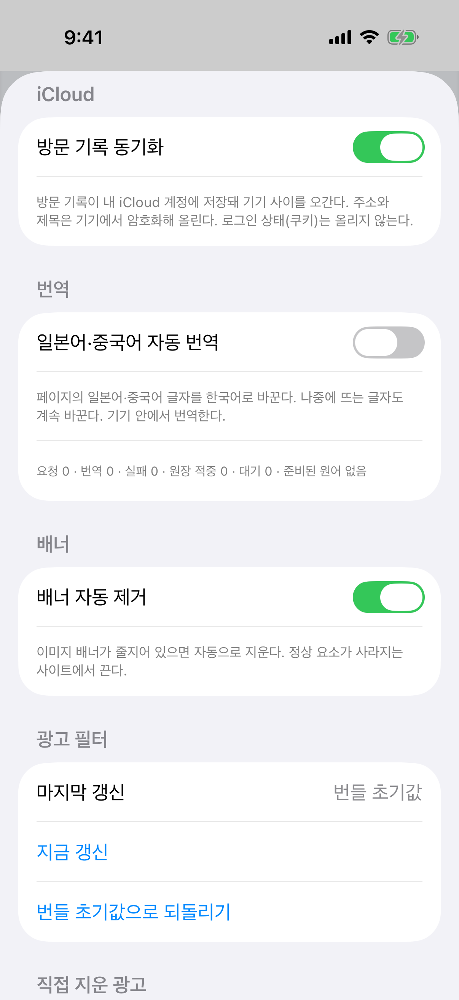

# Slate

개인용 iOS 웹 브라우저. 광고·팝업·전면 오버레이를 3층(콘텐츠 규칙 목록·팝업 거부·오버레이 제거 스크립트)으로 차단하고, 자격 증명 저장은 iOS 시스템 키체인 자동완성에 맡긴다.

| 브라우징 | 탭 격자 | 방문 기록 타임라인 | 페이지 내 찾기 | 설정 |
|---|---|---|---|---|
|  |  |  |  |  |

## 빌드

1. `brew install xcodegen`
2. `xcodegen generate` — `Slate.xcodeproj` 생성 (git에 커밋 안 함, 매번 재생성)
3. `Slate.xcodeproj`를 Xcode에서 연다
4. 타깃 Slate → Signing & Capabilities → Team에서 개인 Apple ID 팀 선택
5. 아이폰 연결 후 Run

배포 서명 값(팀 ID·API 키·인증서 저장소)은 환경 변수로 주입한다 — FASTLANE_TEAM_ID, APP_STORE_CONNECT_API_KEY_PATH, MATCH_GIT_URL, MATCH_PASSWORD.

## TestFlight

케이블 없이 설치하는 경로. 위 배포 환경 변수를 주입한 셸에서 실행한다.

1. 최초 1회: `bundle install && bundle exec fastlane ios certs` — 번들 ID를 개발자 포털에 등록하고 인증서·프로파일을 만들어 MATCH_GIT_URL 저장소에 저장
2. 최초 1회: App Store Connect 웹에서 앱 레코드 생성 (이름 slate, 번들 `com.wonseon.slate`)
3. 업로드: `bundle exec fastlane ios beta` — 빌드 번호는 실행 시각으로 자동 부여
4. 아이폰 TestFlight 앱에서 설치 (내부 테스터는 베타 심사 없음)

Apple이 기본 브라우저 entitlement를 승인하면 `com.apple.developer.web-browser`가 프로젝트에 추가된다 (entitlements 파일 + 서명). 신청은 https://developer.apple.com/contact/request/default-browser-entitlement/ 에서 한다.

## 탭 메모리

보는 탭의 웹뷰만 보이고 나머지는 UIKit hidden으로 둔다. 계층에는 남아 스크롤 위치를 지키되, WebKit에는 안 보이는 페이지로 잡혀 웹 프로세스가 배경으로 내려간다. 페이지 그림은 보는 탭만 메모리에 들고, 다른 탭의 카드는 디스크 그림으로 그린다.

iOS가 메모리 부족을 알리면 보는 탭 하나만 남기고 나머지 페이지를 내린다(절전). 뒤로가기 이력은 들고 있다가 그 탭을 다시 고르면 그 자리로 되살린다. 주소창과 격자 카드는 그대로다. 설정 → iCloud 절에 탭 수와 살아 있는 페이지 수, 앱이 더 쓸 수 있는 메모리가 보인다.

## 닫은 탭 다시 열기

탭 격자 하단의 "+"를 길게 누르면 "닫은 탭 다시 열기"가 뜬다. 최근 10개까지 되살린다. 앱을 끄기 전까지는 뒤로가기 이력까지 돌아오고, 재시작 뒤에는 주소만 돌아온다.

## 방문 기록 타임라인

더보기(⋯) 메뉴 → "방문 기록". 세로 타임라인 한 줄에 같은 탭의 연속 방문을 카드 하나로 접는다 — 같은 탭이라도 1시간 넘게 비면 카드를 끊는다. 카드 오른쪽 화살표로 사슬을 펼친다.

카드는 탭의 현재 상태를 업는다. 상태는 저장하지 않고 열 때마다 판정한다.

| 상태 | 표시 | 카드 머리를 누르면 |
|---|---|---|
| 지금 보는 탭 | "현재" 배지 | 타임라인만 닫는다 |
| 열려 있는 다른 탭 | 초록 점 | 그 탭으로 전환 (새 탭 안 만듦) |
| 닫혔지만 복원 가능 | ↩ 아이콘 + "되살리기" | 뒤로가기 이력째 통째 복원 |
| 기록만 남음 | 회색 점 | 마지막 페이지를 새 탭으로 |

펼친 사슬의 항목을 누르면: 산 탭이면 전환하고 뒤로가기 목록에서 그 지점으로 이동(이력 보존), 목록에 없거나 죽은 탭이면 새 탭으로 연다. 항목은 왼쪽 스와이프로 삭제, 왼쪽 위 "전체 삭제"로 다 지운다. 검색 줄은 카드 대신 방문 낱줄을 찾는다.

기록 규칙: 최종 주소만 찍는다(리다이렉트 중간 주소 제외). 새로고침·조각(#) 이동은 시각만 갱신. SPA 이동(유튜브 영상 넘기기 등)은 로드 없는 주소 변화로 찍는다. 탭 전환 자체는 방문이 아니다. 기록은 `history.json` 로컬 파일뿐 — 서버 없음. 되살린 탭과 "새 탭에서 열기"로 연 탭은 새 카드로 시작하고 원래 카드의 마지막 방문에 이어진다(↰ 표시).

페이지 그림은 격자 카드 폭(200pt)으로 찍고, 찍는 즉시 메인 스레드에서 앱 소유 비트맵으로 복사한 뒤에만 탭·디스크로 넘긴다 — WebKit이 준 그림은 웹 프로세스와 나눠 쓰는 메모리에 얹혀 있어 뒤늦게 다른 스레드에서 읽으면 죽는다.

저장 규칙: 변경은 1초 모아 배경 스레드에서 한 번에 쓰고, 앱이 백그라운드로 빠질 때 바로 쓴다. iCloud 레코드의 시스템 필드는 `history.json`에 넣지 않고 `history-records/` 폴더에 방문별 파일로 둔다 — 방문 하나가 바뀔 때 원장 전체와 그 덩어리들을 매번 다시 쓰지 않는다. 설정 → iCloud에 방문 수와 파일 크기가 보인다.

## 새 탭에서 열기

링크를 길게 누르면 메뉴 맨 위에 "새 탭에서 열기"가 뜬다. 새 탭으로 전환한다.

## 탭 고정

더보기(⋯) 메뉴 → "이 탭 고정". 고정한 탭에서 다른 페이지로 가는 이동은 이 페이지를 남기고 새 탭에서 열려 전환된다. 쪽 넘김(경로의 숫자만 다르거나, 경로는 같고 쿼리·#만 다른 이동)은 제자리에서 간다. 갈라져 나온 탭은 격자 맨 위의 고정 그룹에 그 고정 탭과 함께 묶인다. 주소창·격자 카드에 초록 핀이 붙는다.

이동을 잡는 층은 셋이다. 링크 클릭은 페이지 안 스크립트가 라우터보다 먼저 가로챈다. 클릭 핸들러가 `location`을 바꾸거나 `window.open`으로 여는 이동은 네이티브 이동 정책이 잡는데, 사용자가 화면을 만진 뒤 2초 안에 난 이동만 돌리고 손 안 댄 리다이렉트·폼 전송·뒤로가기·새로고침은 제자리에서 간다. SPA 라우터가 `pushState`로 제자리에서 넘어가면 그 주소 변경을 삼키고 새 탭을 연 뒤 `popstate`를 쏴 라우터가 원래 화면을 되살리게 한다. 뒤로가기 목록에는 남지 않는다.

## 사이트별 광고 차단

더보기(⋯) 메뉴 → "이 사이트 광고 차단". 사이트(등록 도메인) 단위로 저장되고, 고르면 그 탭에 바로 적용해 새로고침한다. 같은 사이트의 다른 탭은 다음 이동 때 따라온다. 설정 → 사이트별 광고 차단에서 목록을 보고 지운다.

| 방식 | 규칙 목록 | 스크립트 | 용도 |
|---|---|---|---|
| 전부 차단 (기본) | 전부 | 전부 | 평소 |
| 감지 회피 | 요소 숨김 규칙을 뺀 목록 | 전부 | "광고 차단기를 꺼 달라"는 사이트 |
| 끄기 | 없음 | 광고를 건드리는 것 제외 | 그래도 안 열리는 사이트 |

감지 회피는 광고 요청은 그대로 막되 미끼 요소를 숨기지 않아, 요소 높이로 차단기를 알아내는 감지를 통과한다. 여기에 모든 방식(끄기 제외)에서 `ad-stubs.js`가 광고 스크립트 껍데기를 먼저 심는다: `adsbygoogle`·`googletag` 전역 객체를 채우고 `ins.adsbygoogle` 자리를 채워진 것으로 표시하며, BlockAdBlock·FuckAdBlock류 감지 라이브러리는 "감지 안 됨"으로만 답하는 가짜로 박아 둔다. 감지 회피 목록은 처음 필요할 때 컴파일해 캐시한다.

## 다른 앱 열기

`kakaotalk:` `itms-apps:` `tel:`처럼 웹뷰가 못 보여주는 스킴의 주소는 웹뷰에 태우지 않는다. 사용자가 누른 링크·보낸 폼, 또는 화면을 만진 뒤 2초 안의 스크립트 이동이면 주소를 보여주고 열지 묻는다. 손 안 댄 채 스크립트가 시도하는 이동은 조용히 버린다. 유니버설 링크로 다른 앱이 열릴 때는 WebKit이 이 탭의 이동을 중단으로 끝내는데, 이건 실패로 치지 않아 페이지가 그대로 남는다.

## 오류 화면

페이지를 열지 못하면 사유 아래에 오류 도메인·코드·실패 주소가 작게 뜬다. 문장은 길게 눌러 복사할 수 있다.

콘텐츠 차단기가 이동 자체를 막은 경우(WebKitErrorDomain 104, 대개 광고 착륙 페이지로 넘기는 이동)는 실패가 아니다. 페이지가 떠 있으면 그 위를 덮지 않고 바 위에 "막은 이동 · 호스트" 띠를 몇 초 띄운다. 빈 탭의 첫 로드가 막혔을 때만 오류 화면이 뜨고, 거기에 "차단 없이 열기"가 붙는다. 띠의 "열기"와 이 버튼은 그 한 번만 규칙 없이 열고, 문서가 뜨면 규칙을 다시 건다. 사이트 설정은 바꾸지 않는다.

## 로그인 유지 (세션 쿠키 복원)

만료일 없는 세션 쿠키는 표준상 프로세스가 죽으면 사라진다 — iOS는 백그라운드 앱을 수시로 죽이므로 그대로 두면 재실행마다 로그인이 풀린다. 데스크톱 크롬의 세션 복원과 같은 층을 둔다: 쿠키 변화를 관찰해 세션 쿠키만 `session-cookies.plist`로 저장하고, 앱 시작 때 첫 페이지 로드 전에 되살린다. 만료일 있는 쿠키는 WebKit이 스스로 보존하므로 안 만진다.

JS로 심은 쿠키의 만료 7일 상한(WebKit 추적 방지)은 앱이 못 끈다 — 로그인이 7일 주기로 풀리는 사이트는 아이폰 설정 → slate → "웹 사이트 간 추적 허용"을 켠다.

## 일본어·중국어 자동 번역

페이지의 일본어·중국어 텍스트 노드와 placeholder·버튼 value 속성을 기기 내 Translation 프레임워크(iOS 18)로 한국어로 바꾼다. 가나가 있으면 일본어, 한자만 있으면 문서에 가나가 있을 때 일본어·없을 때 중국어(간체·번체는 NaturalLanguage로 판정)로 보낸다. 문서 로드 뒤 한 번 전체를 훑고, 이후에는 관찰자가 알려준 바뀐 노드(추가된 서브트리·바뀐 텍스트·바뀐 속성)만 300ms 디바운스로 본다 — 대사창처럼 글자만 갈아끼우는 페이지도 따라간다. 탭이 숨겨져 있으면 멈추고 돌아오면 이어서 본다. 번역문은 앱 원장(`Application Support/slate/translations.json`, 상한 5만 항목)에 남아 같은 문구는 페이지·탭·실행을 넘어 한 번만 번역한다. 묶음은 60개씩 보내고, 모델이 묶음을 거부하면 20개·낱개로 쪼개 다시 보낸다. 캔버스에 그린 글자는 대상이 아니다. 설정 → 번역에서 끈다(기본 켜짐, 끄면 다음 로드부터). 원어별 첫 사용 때 언어팩 설치 창이 뜬다.

원문을 복사하거나 확인할 때는 더보기(⋯) 메뉴 → "원문 보기". 새로고침 없이 그 탭의 번역된 글자를 제자리에서 원문으로 되돌리고, 켜진 동안은 새 글자를 번역하지 않는다. 끄면 번역으로 돌아오고 미뤄 둔 글자도 이어서 번역한다. 다른 페이지로 가면 번역으로 시작한다.

## 필터 갱신

앱 내 설정 화면(하단 툴바 톱니 아이콘) → "지금 갱신" 버튼. EasyList·List-KR 최신본을 내려받아 콘텐츠 규칙 목록을 재컴파일한다. 자동 갱신 없음 — 수동 버튼만.

## 남은 광고 직접 지우기

필터 목록이 못 잡는 배너(사이트 자체 CDN에서 오는 이미지 배너)는 두 가지로 지운다.

1. 자동 — 외부 도메인으로 나가는 이미지 한 장짜리 배너 중, 텍스트가 없고 렌더 너비 200px 이상이면서 가로세로 비 2.5 이상이고 같은 부모 밑에 같은 조건의 형제가 2개 이상 있으면 지운다. 설정 화면 "배너" 섹션의 "배너 자동 제거" 스위치로 끈다.
2. 수동 — 웹 화면을 길게 눌러 "광고 제거"를 고르고, 지울 영역을 사각형으로 드래그한 뒤 "제거"를 누른다. 면적의 60% 이상이 사각형에 든 최상위 요소가 지워지고(사각형보다 2.5배 넘게 큰 요소는 제외), 규칙이 저장돼 다음 방문부터 자동 적용된다. 설정 화면 "직접 지운 광고" 섹션에서 사이트별로 확인·삭제한다. 규칙마다 왼쪽 토글로 켜고 끌 수 있다 — 규칙이 정상 요소까지 지워 페이지가 깨지면 하나씩 꺼서 범인을 찾은 뒤 삭제한다. 끈 규칙은 목록에 남고 적용만 안 된다.

규칙은 저장한 호스트와 방문한 호스트가 둘 다 숫자로 끝나고 그 숫자를 뗀 나머지가 같으면 같은 사이트로 본다. `site7.com`에서 만든 규칙이 `site8.com`에서도 먹는다. 한쪽이라도 숫자가 없으면 정확히 일치할 때만 적용된다.

## 팝업·이동 차단

스크립트가 여는 창과 이동은 `popup-guard.js`가 막는다. 외부 사이트로 향하는 `window.open`에는 성공한 것처럼 보이는 빈 창 객체를 돌려줘 광고 스크립트가 다음 수단(가짜 링크 클릭·주소 이동)으로 넘어가지 않게 하고, 사용자 탭이 아닌 스크립트가 만든 클릭으로 외부 앵커를 누르는 것은 취소한다. 사용자가 방금 누른 앵커가 가리키는 주소로 여는 창만 진짜로 연다.

`location.href` 직접 이동과 화면을 덮은 투명 낚시 앵커는 JS로 못 막는다 — popup-guard가 뭔가를 막은 순간 네이티브에 신호를 보내고, 네이티브 이동 정책이 그 직후의 딴 사이트 이동을 자른다: 스크립트 주도 이동은 3초, 링크 탭은 같은 제스처(1초) 안만. 신호가 없던 페이지의 정상 이동(OAuth 리다이렉트 등)은 건드리지 않는다.

스크립트가 딴 사이트로 보내는 이동은 페이지를 벗어나지 않는다. 화면을 만진 뒤 2초 안에 스크립트가 시작한 딴 사이트 이동은, 누른 앵커가 그 사이트를 가리키는 경우가 아니면 끊고 바 위에 "딴 사이트로 보내는 이동을 막았다 · 호스트" 띠를 띄운다. 띠의 "열기"로 그 주소에 그냥 갈 수 있다. 손 안 댄 리다이렉트(로그인 흐름)는 통과한다. 고정 탭의 새 탭 우회는 같은 사이트 안 스크립트 이동에만 건다.

스크립트가 여는 같은 사이트 창(`window.open`)은 누른 앵커와 같은 주소일 때만 현재 탭(고정 탭이면 새 탭)에 싣고 나머지는 버린다 — 같은 사이트의 광고 중계 페이지를 아무 클릭에나 여는 수법이 있다. 사용자가 직접 누른 `target=_blank` 링크는 싣는다.

막힌 이동의 출발점이 글도 그림도 없는 페이지면 광고 중계 페이지다 — 사용자가 보던 이전 페이지로 돌아간다.

클릭 가로채기는 되돌린다. 사용자가 누른 앵커의 주소를 popup-guard가 기억해 두었다가, 페이지 핸들러가 그 앵커의 기본 이동을 막고(preventDefault) 스크립트로 딴 사이트로 보내려 하면 그 이동을 끊고 누른 링크로 간다 — 고정 탭이면 새 탭으로. 광고 창을 가짜로 넘긴 뒤 기본 이동까지 막힌 클릭도 같은 규칙으로 누른 링크를 따라간다. 콘텐츠 차단기가 그 광고 이동을 먼저 막은 경우도 마찬가지다. 바 위에 "광고로 넘기는 이동을 막고 누른 링크로 갑니다" 띠가 잠깐 뜬다. 누른 링크 자체가 딴 사이트거나(로그인 등) 핸들러가 기본 이동을 막지 않았으면 건드리지 않는다.

## 쿠키 규칙

설정 → 쿠키 규칙. 도메인·이름·값·만료(일)를 넣으면 앱을 켤 때 첫 페이지 로드 전에 그 도메인에 쿠키를 심는다. 해외에서 지역·연령 확인으로 막히는 사이트가, 그 확인을 통과하면 심어 주는 쿠키를 미리 박아 관문을 건너뛰는 용도다.

브라우저 확장의 쿠키 심기 scriptlet과 결과는 같지만 접근이 다르다 — 확장은 문서 컨텍스트 제약 때문에 크로스도메인 쿠키를 못 심어 각 도메인을 백그라운드로 방문해야 하지만, slate는 네이티브 쿠키 저장소(`WKHTTPCookieStore`)에 도메인 상관없이 직접 넣는다. 한 관문이 여러 도메인에 걸쳐 있으면 도메인마다 규칙을 하나씩 넣으면 된다. 앞에 점이 붙은 도메인(`.example.co.jp`)은 서브도메인까지 먹는다. 값은 기기에만 저장되고 어디로도 나가지 않는다.

## 한계

- uBlock Origin의 scriptlet 주입(예: 특정 사이트 전용 우회 스크립트)은 재현하지 않는다. 오버레이 제거는 범용 휴리스틱 스크립트 하나뿐.
- 기본 브라우저 entitlement 승인 전에는 앱이 시스템 자동완성 대상으로 등록되지 않아, 로그인 폼에서 키보드 위 열쇠 버튼을 눌러 키체인 자격 증명을 수동으로 선택해야 한다.
- 영역 지목으로 만든 규칙 중 DOM 경로로 저장된 것은 사이트 개편 시 깨진다. 다시 지목하면 된다.
- 공유 버튼처럼 `<button>`에서 `window.open`으로 외부 창을 여는 기능은 동작하지 않는다(가짜 창을 받는다).
- 배너 자동 제거는 보수적이라(같은 부모 밑에 형제가 2개 이상 있을 때만) 단독으로 놓인 광고는 남는다.
- 감지 회피는 광고 서버의 응답 여부로 차단기를 알아내는 사이트는 통과하지 못한다. 그런 사이트는 "끄기"만 남는다.
- 고정 탭의 `pushState` 되돌리기는 라우터가 `popstate`를 처리하는 사이트에서만 원래 화면으로 돌아온다. 안 처리하면 주소는 원래 페이지인데 화면은 상세로 남는다.
- 원문 보기는 메인 문서와 번역을 요청해 온 프레임에만 닿는다.

## 라이선스

GPL-3.0 (`LICENSE`). 콘텐츠 규칙 컴파일에 쓰는 [AdGuard SafariConverterLib](https://github.com/AdguardTeam/SafariConverterLib)가 GPL-3.0이라 전체를 같은 라이선스로 배포한다.

`Slate/Resources/filters/`의 차단 목록은 서드파티 데이터로, 각자의 라이선스를 따른다: [EasyList](https://easylist.to/pages/licence.html)(GPL-3.0 / CC BY-SA 3.0 이중), [List-KR](https://github.com/List-KR/List-KR/blob/master/LICENSE)(GPL-3.0), [YousList](https://github.com/yous/YousList#license)(CC BY 4.0). 앱은 이 사본을 씨앗으로 쓰고 설정의 "지금 갱신"으로 최신본을 내려받는다.
